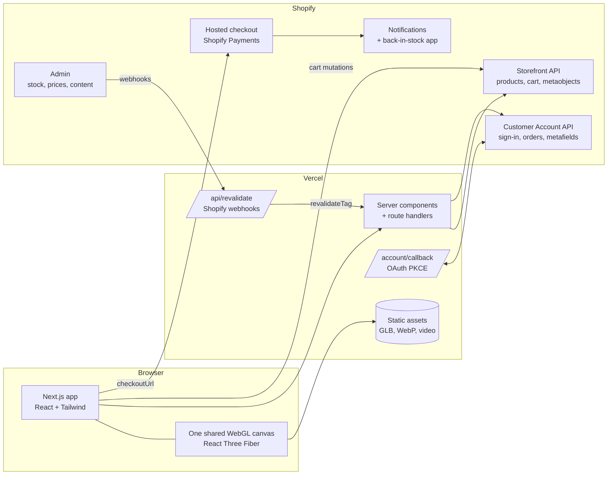

# TeraShoes Flux 01: Technical Requirements (TRD)

| | |
|---|---|
| Status | Draft. §2 and §3 reflect the Step 1 setup (2026-10-17). |
| Inputs | [instructions.md](instructions.md), [PRD](PRD.md) |
| Related | [Backend schema](Backend_Schema.md), [UI/UX spec](UI_UX.md), [User flows](User_Flow.md) |

## 1. Architecture

The site is a **Next.js front end on Vercel**, with **Shopify as a headless backend**. We run no database and no server of our own beyond Next.js route handlers.



**Shopify owns** products, variants, stock, prices, discounts, carts, checkout, payments, tax, shipping, customers, orders, and transactional email.

**The site owns** rendering, 3D, motion, the colourway tokens, and the cache.

## 2. Stack (C1)

Installed in Steps 1 to 3, with exact versions pinned in `package.json` and `pnpm-lock.yaml`. The package manager is pnpm 10 on Node 24 (`.nvmrc`), and the minimum is Node 22.12.

| Concern | Choice (version) | Notes |
|---|---|---|
| Framework | Next.js 16.4 (App Router, Turbopack, `cacheComponents`), React 19.3, TypeScript 5.9 `strict` + `noUncheckedIndexedAccess` | Server components for catalogue and content. Client components for 3D, motion, bag and wishlist. TypeScript 7 is out but stays unused until Next.js supports it. |
| Styling | The prototype stylesheet copied verbatim (`src/styles/prototype.css`), plus Tailwind 4.3 theme and utilities **without its preflight reset**, configured in CSS (`src/app/globals.css`) | The prototype CSS relies on browser defaults, so the reset is left out. Tailwind utilities map onto the prototype's CSS variables. |
| 3D | three **0.160.0** (the prototype's version), `@react-three/fiber` 9.8 | One `<Canvas id="gl">`, fixed full-screen above the page with no pointer events. `src/three/stage.ts` ports the prototype's scene and per-frame logic. R3F owns the renderer, camera and loop. |
| Motion | GSAP **3.12.5** (+ ScrollTrigger, Flip) and Lenis **1.1.13**: the prototype's exact versions | Pinned to the versions the prototype loads, so its motion code behaves the same. GSAP drives timelines; Lenis drives scrolling from GSAP's ticker. |
| Validation | zod 4.6 | Environment variables (C2 onwards) |
| Data | Storefront API (GraphQL) with a typed client from GraphQL Codegen | Added in C2. C2 requires a "typed Storefront API client". |
| Auth | Shopify Customer Account API (OAuth 2.0 + PKCE) | Tokens in httpOnly cookies. Added in C7. |
| Lint/format | ESLint 9 (`eslint-config-next` core-web-vitals + TypeScript, flat config), Prettier 3.9 + Tailwind class sorting, `tsc --noEmit` | `pnpm check` runs all of them plus the unit tests |
| Tests | Vitest 5 + happy-dom + Testing Library (unit), Playwright 1.64 (end-to-end, desktop and Pixel 7 projects) | glTF Validator and Lighthouse CI come with A2 and launch. See §11. |
| 3D tooling | Blender (A2), `@gltf-transform/cli` for compression | Added in A2. See §6. |
| Hosting | Vercel, with a preview deployment per branch | C1 is done when a pushed branch gets a working preview link. That needs a GitHub remote and a Vercel project. |

## 3. Repository layout

```
TeraShoesFlux/
  prototype/                    # the original single-file prototype, the reference for every detail
  docs/
  src/
    app/
      layout.tsx                # fonts (next/font), <SmoothScroll>
      page.tsx                  # the storefront in the prototype's DOM order
      globals.css               # Tailwind theme + utilities (no reset), then the prototype stylesheet
    styles/prototype.css        # prototype CSS, verbatim and in order (only the font stacks changed)
    data/catalogue.ts           # PRODUCTS, SIZES, FAQ, band words: copied from the prototype
    state/
      store.ts                  # shared state (colourway, size, bag, wishlist, overlays, thumbnails)
      actions.ts                # the prototype's functions: select, addToCart, toggleWish, flood, …
    components/
      layout/                   # Header, Menu, Band, Footer, Overlays (to-top, scrim, bag, search, toast)
      sections/                 # Hero, Tour, ProductSection, ShopGrid, Perks, Faq
      store/Thumb.tsx           # live 3D renders used as product images
      ui/                       # Icons (SVG sprite), Accordion
    motion/
      gsap.ts                   # plugin registration and the reduced-motion flag
      SmoothScroll.tsx          # Lenis on the GSAP ticker, goTo()
      PageMotion.tsx            # intro, reveals, progress bar, header state, links, keys, magnetic buttons
    three/
      SceneMount.tsx, Scene.tsx # client-only canvas with a no-WebGL fallback message
      stage.ts                  # the prototype's 3D scene: docking, balls, drag, colour change, thumbnails
      stageState.ts             # values GSAP tweens and the stage reads (S.a, turn, intro, …)
      materials/zoneRecolour.ts # parked A3 recolour shader (not used while the prototype look is final)
    lib/                        # contrast helpers; shopify/ for C2
  scripts/                      # check, contrast report, assets/ (A2 pipeline and model build)
  public/3d/flux01/             # the shoe (glTF + Meshopt, WebP textures) and the prototype's colourway textures
  licenses/                     # shoe model credit (CC BY 4.0); the A8 character licence goes here
  e2e/                          # Playwright specs
```

> **Current build follows the prototype exactly.** Colourways are the prototype's six, recoloured with one texture per colourway as the prototype does. The scroll docking uses the prototype's own mechanism (live anchor positions, with ScrollTrigger segments tweening `S.a`). The token file, recolour shader and single scroll controller described in §4–5 are the planned replacements once the product owner moves past the prototype.

## 4. One canvas and the docking model

The prototype keeps **one fixed canvas** above the page and moves one shoe between empty DOM "anchors": `#a-hero`, `#a-story`, `#a-pdp`, and a point above the shop. We keep this model:

- Each docking section renders an empty `<Anchor id="hero" pose={…}>` element. Its pose sets scale (as a fraction of the anchor's width), rotation (`rx`, `ry`, `rz`), shadow and visibility.
- Every frame, the shoe's screen position comes from the **live `getBoundingClientRect()`** of the two anchors it sits between. Layout changes, resizes and font loading can't desync it.
- Pixel positions are converted to world units through the camera's frustum: `halfH = tan(fov/2) · z`.

### 4.1 Single scroll controller (B1)

**Problem in the prototype snapshot:** four ScrollTriggers each tween the same `S.a` value (hero→tour, tour chapters, tour→product, product→shop). When you scroll fast in both directions, their `scrub` lag overlaps and they overwrite each other, so the shoe jumps or sticks.

**Rule:** exactly **one** writer to the shoe's progress value.

```ts
// Runs once per frame (gsap.ticker / useFrame); nothing else writes `progress`.
const target = progressFromAnchors(anchors, viewportCenterY); // piecewise: 0 hero … 5 shop
state.progress = damp(state.progress, target, LAMBDA, dt);    // frame-rate independent easing
pose = interpolatePoses(anchors, state.progress);              // position from live rects, rotation lerp
```

- `progressFromAnchors` maps the viewport position between consecutive anchor centres to `i + t`. Tour chapters add hold zones where `t` stays flat, so B4's "holds still long enough to read" check passes.
- `damp` is exponential smoothing (`x + (target - x) · (1 - e^(-λ·dt))`), so it behaves the same at 30, 60 and 120 fps.
- Other animation channels add on top of the docked pose, never in place of it: intro, colour-change spin, cursor tilt, idle bob and drag-to-rotate.
- **Test:** a Playwright test scrolls quickly up and down and records the shoe's screen position each frame. It fails if any frame-to-frame jump goes over a threshold, or if the shoe stops moving while scrolling continues.

## 5. Colourway rendering (A3, A4)

- **Tokens:** `tokens/colourways.json` (schema in [Backend schema §4](Backend_Schema.md)) is the only place colourway colours live. It feeds the Tailwind `@theme` (A5), the shader uniforms (A3), the CSS custom properties `--hl`, `--on-hl` and `--hero-ink`, and the Shopify colour swatches.
- **Mask map:** one RGB texture baked in Blender. R = upper, G = stripes, B = sole, and black means fixed parts (laces, lining). It shares the model's UVs.
- **Shader:** extend `MeshStandardMaterial` / `MeshPhysicalMaterial` with `onBeforeCompile` (or drei's shader material) so PBR lighting, the AO map, the normal map and roughness stay standard. Only the base colour is replaced:
  `base = mix(base, uUpper * detail, mask.r); base = mix(base, uStripes * detail, mask.g); base = mix(base, uSole * detail, mask.b)`
  Here `detail` is the greyscale knit or foam texture, so the weave survives recolouring.
- **Colour change (B3):** tween the uniforms (in linear colour space) and the CSS custom properties together on one GSAP timeline. Nothing loads, so there is no flicker.
- **Done when:** 8 colourways render from `flux01.glb` plus the one mask and detail set, with no per-colourway textures.

## 6. 3D asset pipeline and budgets

| Asset | Budget | Gate |
|---|---|---|
| `flux01-shoe.glb` (mesh + normal + ORM) | < 3 MB, < 40k triangles | glTF Validator: 0 errors (`pnpm assets:validate`) |
| `character.glb` (rig + idle + swing) | < 2 MB | Both clips loop with no pop. Validator: 0 errors. |
| Props | Procedural (code), ~0 KB | Built in code as in the prototype |
| Hero video fallback | 10 s loop, WebM + MP4 | B8 |
| **Total 3D on first view** | **Target ≤ 4 MB** (prototype: ~9.8 MB downloaded) | Lighthouse CI asset-size budget |

Pipeline: Blender export → `pnpm assets:shoe` (gltf-transform: drop colour textures and variants, weld, dedup, prune, WebP textures at 1024 px, Meshopt geometry) → `pnpm assets:validate` → `public/3d/`. The zone mask ships next to the GLB as one WebP. The prototype's workaround of inlining geometry as base64 in JSON is dropped. KTX2 can replace WebP later if GPU memory on phones becomes a problem (it needs the `toktx` tool). Step-by-step instructions are in [docs/assets/A2_A3_Pipeline.md](assets/A2_A3_Pipeline.md). The development stand-in keeps the prototype's original textures for now, so it is exempt from the budget.

## 7. Data, caching and freshness (C2, C8)

- Catalogue and content are fetched in **server components** through the typed client. Each fetch is tagged: `products`, `product:{handle}`, `content`.
- **Stock without a redeploy:** Shopify webhooks (`products/update`, `inventory_levels/update`, `metaobjects/*`) call `POST /api/revalidate`. That route checks the HMAC signature and calls `revalidateTag`. As a safety net, product data revalidates every 60 s.
- **Live stock at the point of decision:** the size picker re-reads `availableForSale` / `quantityAvailable` on the client when the product page mounts and when the colour changes. Showing `quantityAvailable` needs the `unauthenticated_read_product_inventory` scope.
- The storefront still renders from cache if Shopify is slow. Cart actions then show a retry toast.

## 8. Cart, checkout, wishlist and accounts (C5–C7)

| Feature | Implementation |
|---|---|
| Cart | Storefront `cartCreate`, `cartLinesAdd/Update/Remove` and `cartDiscountCodesUpdate`, called from server actions. The cart ID is kept in an httpOnly cookie, so the bag **survives a refresh**. |
| Cart on a second device | When a customer signs in: `cartBuyerIdentityUpdate`, and the cart ID is saved to customer metafield `custom.active_cart_id`. On another device after sign-in, that cart is read and its lines merged into the local cart. |
| Free-shipping meter | Threshold from the `site_settings` metaobject (the prototype uses $150). The real rates live in Shopify shipping zones and must match. |
| Checkout (C6) | Redirect to `cart.checkoutUrl`, which is Shopify's hosted checkout. **India:** Shopify Payments isn't available, so payment runs through a third-party gateway configured in Shopify (Razorpay, Cashfree or PayU: UPI, cards, netbanking, wallets), plus Shopify's built-in cash on delivery. Prices include GST. **Test:** gateway test mode, then a low-value order that is refunded. |
| Accounts (C7) | Customer Account API, OAuth 2.0 + PKCE as a public client. Order history comes from the `customer.orders` query. |
| Wishlist | Guests: `localStorage`. Signed in: customer metafield `custom.wishlist`, written with the Customer Account API `metafieldsSet` mutation. This needs a metafield definition with customer-account read/write access and protected-customer-data approval. At sign-in, the guest and account lists are merged. |
| Search | The colourway list is small (8), so search runs on the client over cached catalogue and tokens, just like the prototype. |

> **Local dev note:** the Customer Account API needs registered HTTPS callback URLs. Plan on a tunnel or a Vercel preview to test sign-in, and confirm the exact requirement at C7.

## 9. Motion system (B-workstream)

- **Lenis** for smooth scroll, driven by `gsap.ticker`. It is turned off under reduced motion and in low-power mode (native scrolling).
- **Timelines as modules:** `intro()`, `colourChange(id, origin)`, `tourChapter(n)`. Each returns a GSAP timeline, so it can be killed on unmount and tested.
- **Budgets:** intro ≤ 2.5 s after model load, colour change ≤ 1.2 s, micro-interactions < 600 ms. Each budget is a constant beside the timeline and asserted in a unit test against `timeline.duration()`.
- **Character (B5):** R3F `useAnimations`. The idle loop crossfades into the swing on colour change, and a head bone uses look-at with clamped yaw and pitch toward the pointer.
- **Low-power mode (B7):** triggered by `prefers-reduced-motion`, the Battery Status API where it exists (`charging === false`), or a measured average frame time over 25 ms. In this mode the frame rate is capped at 30 fps, DPR at 1, and props are fewer.
- **No WebGL (B8):** if WebGL context creation fails or the context is lost, the canvas is swapped for `<video autoplay muted loop playsinline poster>` (WebM first, then MP4).

## 10. Performance

- DPR is capped at 2 (1.5 on phones). The canvas renders only while something is visible (the prototype already skips rendering when the shoe and props are offscreen).
- The model loads after first paint. A poster frame of the hero colour and headline is the LCP element, and the canvas fades in over it.
- The character GLB loads after the shoe, at idle priority.
- Fonts are self-hosted with `next/font`, subset to Archivo (variable wdth/wght), Hanken Grotesk and JetBrains Mono.
- Product images (A9) are served through Shopify's CDN at responsive sizes.

## 11. Testing and CI

| Check | Tool | Gate |
|---|---|---|
| Types, lint, format | `tsc`, ESLint, Prettier | Every push |
| Colourway contrast | `scripts/contrast-check.ts` | Fails the build below AA (A4) |
| Unit | Vitest: progress mapping, damping, token loader, cart line merge, timeline durations | Every push |
| End-to-end | Playwright on the Vercel preview: filter URL round-trip (C3), sold-out size can't be added (C4), bag survives a reload (C5), reduced-motion nothing animates (B7), WebGL off shows the video (B8), scroll-jump test (B1) | Every pull request |
| 3D assets | glTF Validator plus a size budget | Whenever `public/3d/**` changes |
| Lighthouse CI | Performance and accessibility budgets on home and product pages | Every pull request |
| Device pass | Real iPhone and Android, mid-range laptop at 60 fps (B5) | Before each milestone |

## 12. Environments and configuration

| Variable | Scope | Purpose |
|---|---|---|
| `SHOPIFY_STORE_DOMAIN` | server | `{shop}.myshopify.com` |
| `SHOPIFY_STOREFRONT_PUBLIC_TOKEN` | client-safe | Storefront API (public access token) |
| `SHOPIFY_STOREFRONT_PRIVATE_TOKEN` | server only | Server-side Storefront requests |
| `SHOPIFY_CUSTOMER_ACCOUNT_CLIENT_ID` / `SHOPIFY_SHOP_ID` | server | Customer Account API OAuth |
| `SHOPIFY_WEBHOOK_SECRET` | server only | HMAC check in `/api/revalidate` |
| `SHOPIFY_API_VERSION` | server | Pinned quarterly API version (for example `2026-10`) |

Environments: **local** (Shopify development store), **preview** (one per branch, development store), **production** (live store). Secrets live in Vercel environment settings and never in the repo.

## 13. Security and privacy

- Private tokens and webhook secrets are server-only. Webhooks are rejected unless the HMAC matches.
- Customer tokens sit in httpOnly, Secure, SameSite=Lax cookies. Customer data is never written to `localStorage`.
- A Content Security Policy allows only our origin, Shopify checkout and CDN domains, and the font origin.
- Card data is never handled. Payment happens entirely on Shopify's hosted checkout.
- The newsletter signup needs explicit marketing consent through Shopify customer marketing consent (OD-9).

## 14. Task to module map

| Task | Main modules |
|---|---|
| A2, A3 | `public/3d/`, `src/three/stage.ts`, `src/three/materials/zoneRecolour.ts`, `scripts/assets/*` |
| A4, A5 | `src/data/catalogue.ts`, `scripts/contrast-check.ts`, `src/app/globals.css`, `src/components/ui/*` |
| A6, A9 | `src/three/Lights.tsx`, `scripts/render-product-images.ts` |
| A7, A8, B5 | `src/three/props/*`, `src/three/Character.tsx` |
| B1–B4 | `src/motion/scroll-controller.ts`, `src/motion/timelines/*` |
| B6–B8 | `src/components/ui/*`, `src/motion/motion-mode.ts`, `public/video/hero-loop.*` |
| C1 | repo scaffold, CI, Vercel project |
| C2, C8 | `src/lib/shopify/*`, `src/app/api/revalidate/route.ts` |
| C3, C4 | `src/app/shop`, `src/app/products/[handle]`, `src/components/store/*` |
| C5–C7 | `src/lib/shopify/cart.ts`, `src/lib/shopify/customer.ts`, `src/app/account/*` |
| C9 | Shopify notification templates (Liquid) plus the back-in-stock app settings |
