# TeraShoes Flux 01: User Flows

| | |
|---|---|
| Status | Draft |
| Related | [PRD](PRD.md), [UI/UX spec](UI_UX.md), [TRD](TRD.md), [Backend schema](Backend_Schema.md) |

The diagrams use Mermaid, which renders on GitHub and in most Markdown viewers. Task IDs in brackets show which task delivers each step.

## 1. Site map

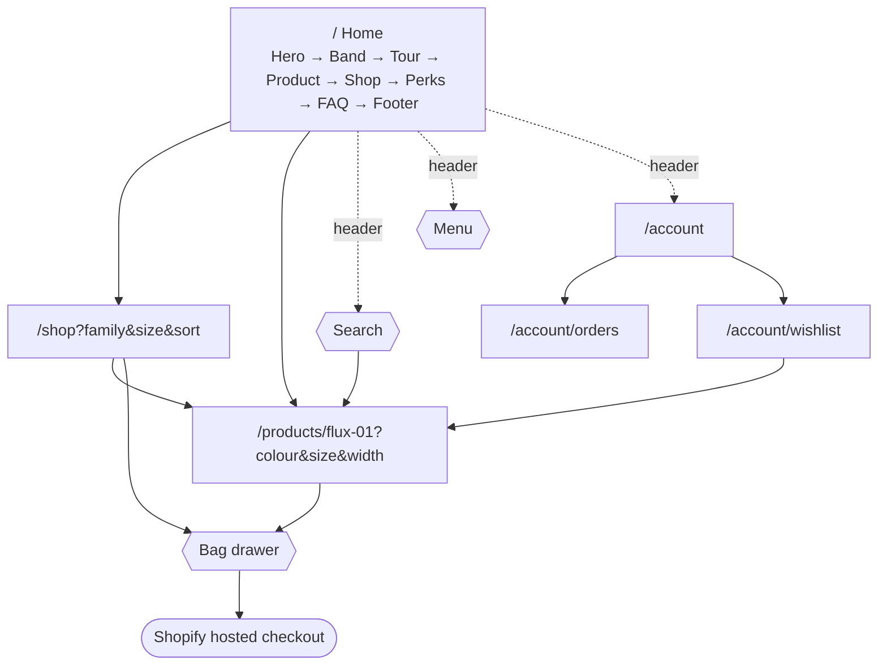

## 2. First visit: discover → buy (the main flow)

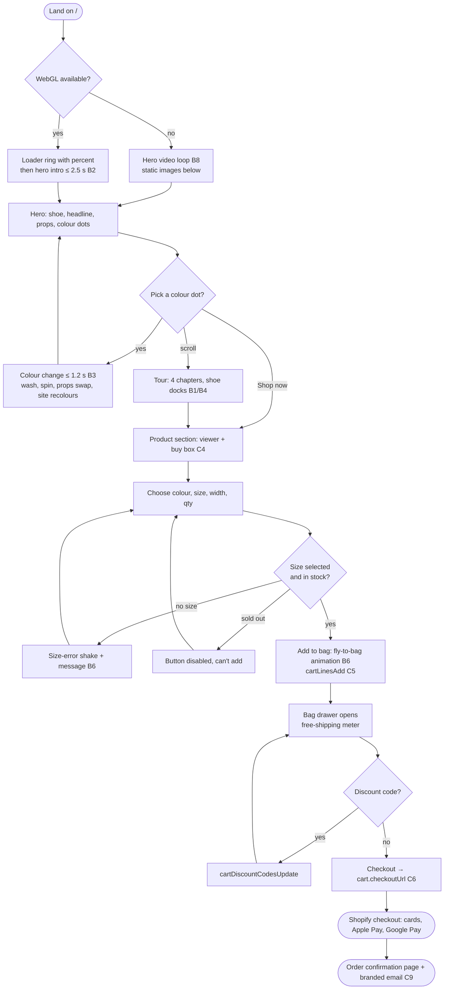

## 3. Colour change (B3)

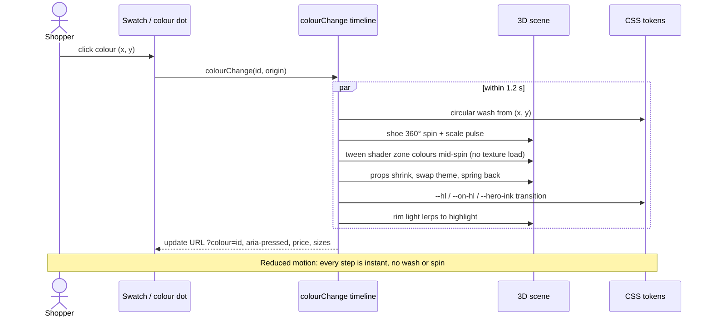

## 4. Shop and filter (C3)

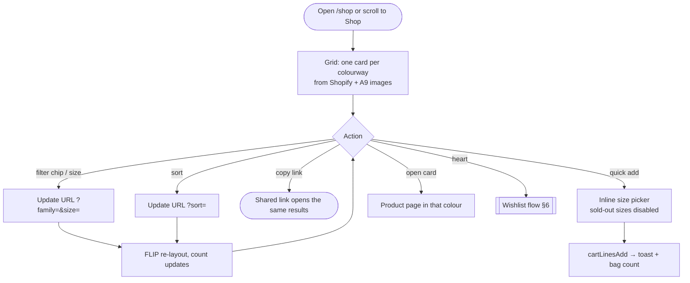

## 5. Search

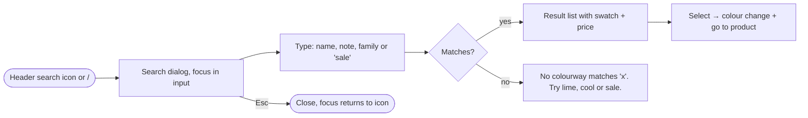

## 6. Wishlist (C7)

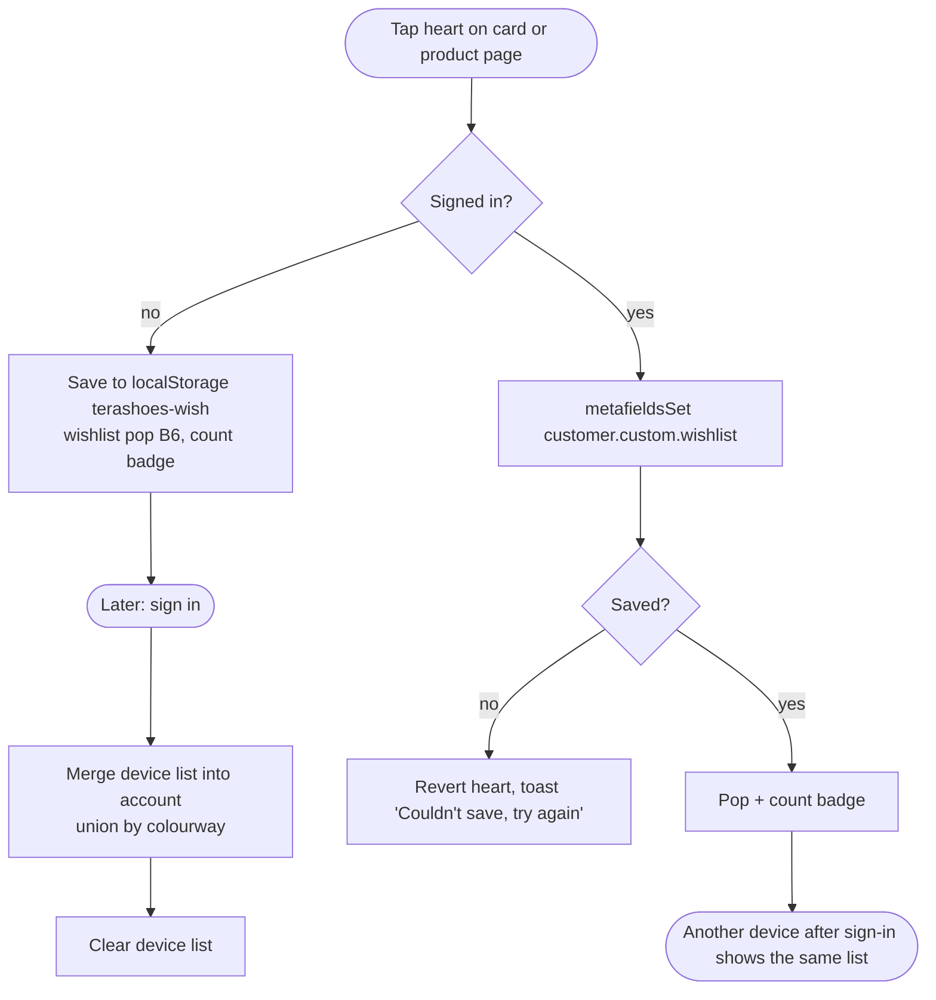

## 7. Bag across refresh and devices (C5)

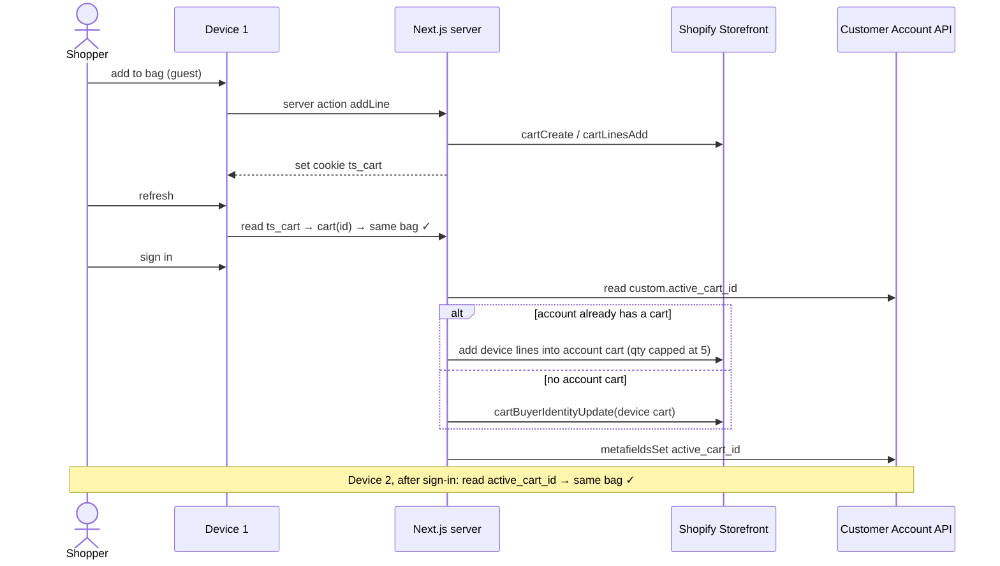

## 8. Sign in and account (C7)

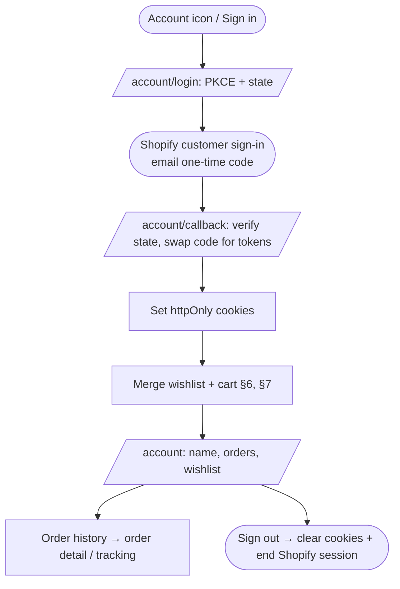

## 9. Checkout and after the order (C6, C9)

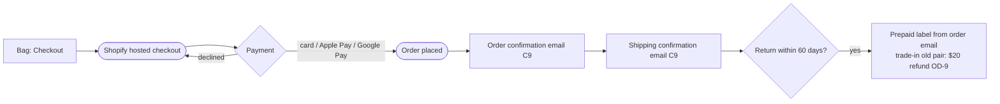

## 10. Back-in-stock (C9, OD-6)

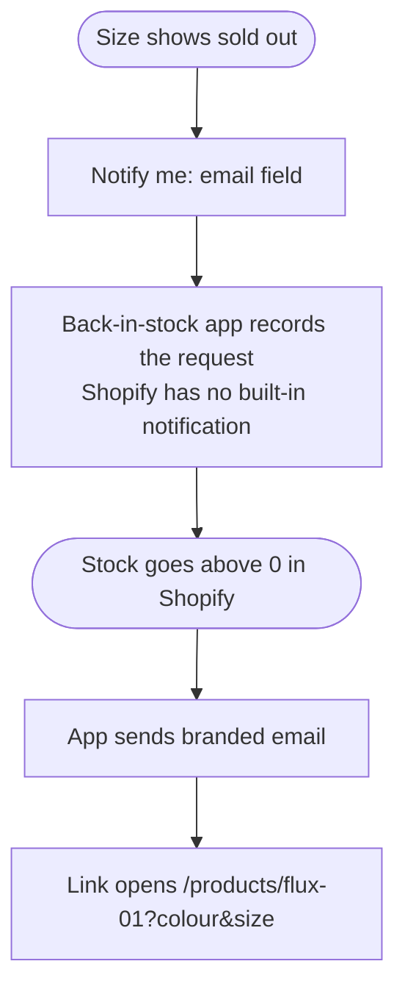

## 11. Product owner: edit content without a developer (C8)

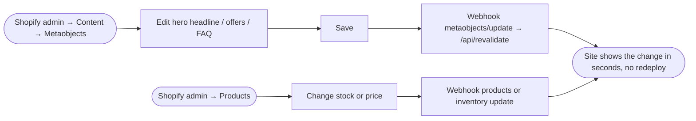

## 12. Reduced motion and fallbacks (B7, B8)

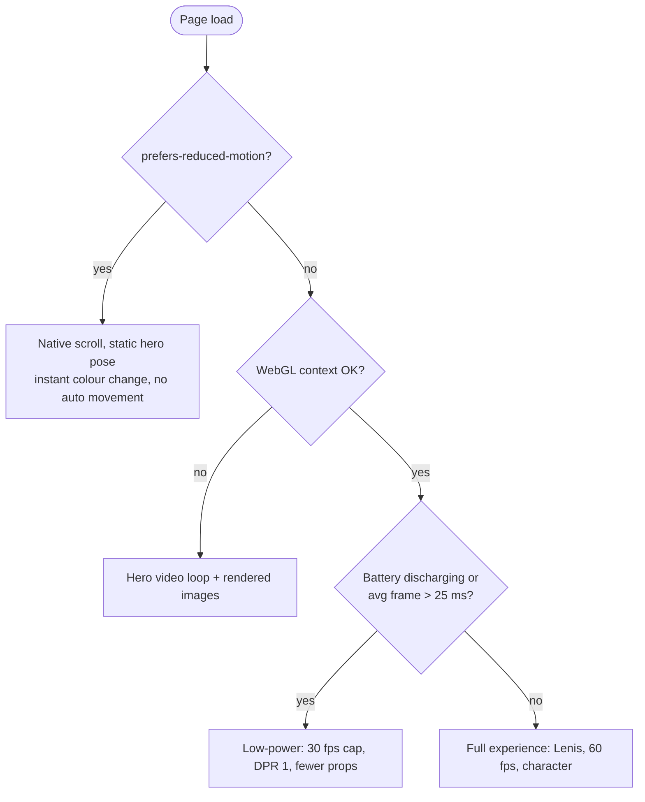

## 13. Error and empty states

| Situation | What the user sees |
|---|---|
| Model fails to load | The loader text changes to "3D shoe could not load". The page stays usable and product images replace the viewer. |
| Shopify slow or down | Catalogue and content render from cache. Bag actions show "Couldn't update your bag, try again". |
| Variant sells out while in the bag | The bag line is marked "Sold out" and checkout is blocked for that line until it's removed |
| Discount code invalid | Inline message under the code field, and totals stay the same |
| Empty bag | "Your bag is empty" with a link to the shop |
| Empty wishlist | Short prompt and a link to the shop |
| No search results | The suggestion text, as in the prototype |
