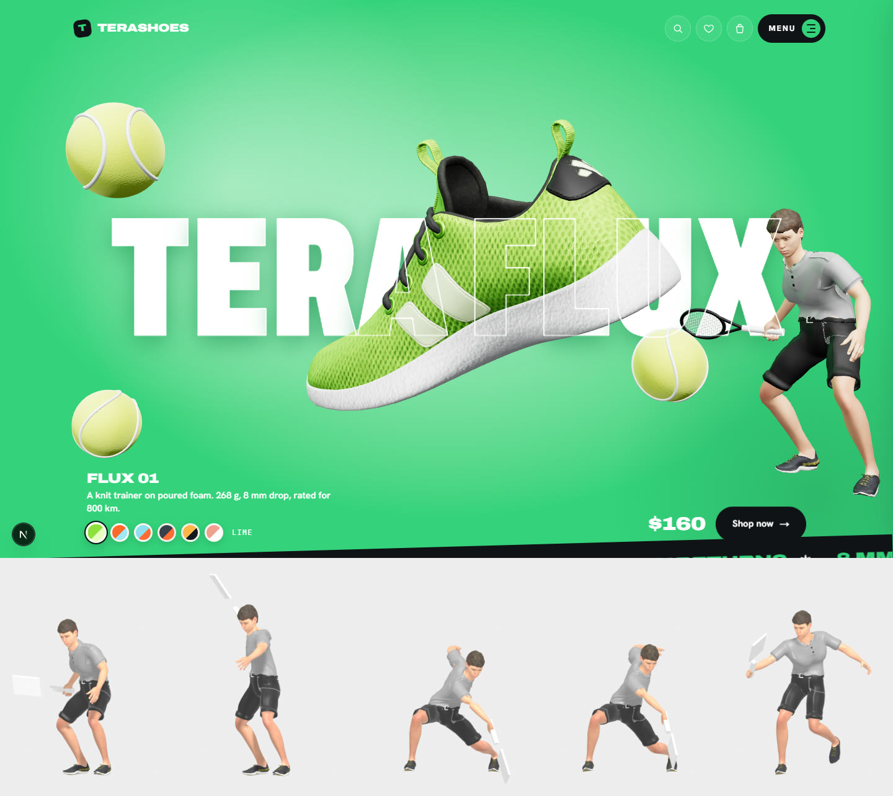

# 3D asset pipeline (A2, A3, A7, A8)

| | |
|---|---|
| Related | [A1 model selection](A1_Model_Selection.md), [TRD §5–6](../TRD.md), [Backend schema §4](../Backend_Schema.md) |

## Status (2026-10-22)

> **Product owner decisions (21–22 Oct 2026):** keep the prototype's shoe (A1, no new model) and its texture recolours (A3). The zone recolour shader below stays parked: not used at runtime, and no mask ships.

| Task | State | What exists | Waiting on |
|---|---|---|---|
| A1 Model | ✅ Decided | The prototype's "Materials Variants Shoe" (CC BY 4.0, `licenses/`) | — |
| A2 Prepare + export | ✅ Done | `pnpm assets:model` → `public/3d/flux01/`: **2.73 MB**, 22,700 triangles, validator 0 errors (budget 3 MB / 40k) | — |
| A3 Recolour | ✅ Decided: texture recolours | One colour texture per colourway, plus the model's built-in "beach" variant for Coral | — (the shader is parked groundwork) |
| A6 Lighting | ✅ Approved (22 Oct 2026): within 3% of a path-traced reference | `STUDIO_LIGHTS` in `src/three/shoeAssets.ts`; `pnpm assets:lighting` ([A6_Lighting_Check.md](A6_Lighting_Check.md)) | — |
| A7 Props | ✅ Components | Tennis ball, racket, shuttlecock, paddle in `src/three/props/` (see `/dev/props`) | Designs checked against the latest prototype (OD-1), prop per colourway (OD-7) |
| A8 Character | ✅ Done | MakeHuman (MPFB2) + Quaternius UAL (idle & swing) → `public/3d/character/character.glb`, 1.84 MB (`pnpm assets:character`) | — |

## The model

```bash
pnpm assets:model      # builds public/3d/flux01/ (shoe.gltf + .bin, WebP textures, the colourway textures)
pnpm assets:validate   # glTF Validator + budgets on everything in public/3d
```

| | Prototype | After `pnpm assets:model` | Budget |
|---|---|---|---|
| Shoe geometry | 0.92 MB (base64 inside JSON) | **0.20 MB** `.bin` (Meshopt) | |
| Model textures (normal, ORM, 3 variant colours) | 6.8 MB of 2048 px JPEGs | **2.53 MB**: the same 2048 px, re-encoded as WebP q88 (38–42 dB PSNR; renders 39–50 dB, no visible change) | |
| Model total | 7.7 MB | **2.73 MB** | < 3 MB |
| Colourway textures | 2048 px JPEGs, loaded per colourway | The same files, unchanged | |
| Triangles | 22,700 | 22,700 | < 40,000 |
| Validator | — | 0 errors, 1 warning | 0 errors |

**Parked shader, for reference.** If the texture recolours are ever replaced, the mask was derived automatically by comparing two of the sample's colour textures (the old `build-standin` script). Its "stripes" zone holds the laces, lining and heel tab, and the side stripes fall into the upper, so a painted mask would be needed.

## How the recolour works (A3)

- The **zone mask** is an RGBA texture on the model's UVs:
  - R = upper
  - G = stripes and overlays
  - B = sole
  - A = detail, the texel's brightness relative to its zone's average ÷ 2, which keeps the knit weave and foam texture
- `src/three/materials/zoneRecolour.ts` clones the model's PBR material and binds the mask as `map`, read as data rather than colour. It replaces three's `map_fragment`:
  `colour = (upper·R + stripes·G + sole·B) / (R+G+B) × A × 2`.
  Normal, AO, roughness, the environment and lights stay standard three.js.
- Zone colours are three uniforms. Changing colourway only changes their values: no texture loads, no shader recompile, no flicker (B3 builds on this).
- Zone colours are passed in as `{ upper, stripes, sole }` (`ZoneColours`).

## A2 with a new model (reference only: the product owner kept the current model)

1. **Blender**: 5.2.2 LTS is installed (`C:\Program Files\Blender Foundation\`).
2. Import the source into Blender and save it as `assets-src/flux01/flux01.blend`. Keep the licence in `licenses/`.
3. Clean up:
   - delete hidden and duplicate parts
   - apply transforms (scale 1, metres)
   - Decimate or retopologise to **< 40k triangles**
   - keep laces as geometry
4. UVs: one non-overlapping UV set. Pack upper, overlays and sole into separate islands where possible.
5. Bake **ambient occlusion** to the AO channel (R) of an ORM texture (R = AO, G = roughness, B = metalness). Bake or keep the normal map.
6. Paint the **zone mask** (A3) in Texture Paint mode on the same UVs: pure red for upper, green for stripes and overlays, blue for sole. Put detail in alpha, or leave it white to use the normal map only. Export it as `flux01-zones.png`.
7. Export glTF 2.0 (`.glb`) with normal and ORM textures and no colour textures, then run:
   ```bash
   pnpm assets:shoe assets-src/flux01/flux01.glb public/3d/flux01-shoe.glb
   ```
   ```bash
   pnpm assets:validate
   ```
8. Convert the mask to `public/3d/flux01-zones.webp`, then point `ASSET_BASE` / `MODEL_URL` in `src/three/stage.ts` at the new files.
9. **Done when (A2):** the validator reports 0 errors, the file is under 3 MB and under 40k triangles. **(A3):** all 8 colourways render correctly from that one model and mask.

## A8: character procedure (MakeHuman + Quaternius)



1. **Character generation:** Built in Blender 5.2 using MPFB2 (MakeHuman Plugin for Blender):
   - Body: adult athletic build, `young_caucasian_male` skin (CC0)
   - Hair: `short02` (CC0)
   - Eyes: `low-poly` (CC0)
   - Clothes: `namuhekam_male_polo_shirt` (CC0), `elvs_male_trouser_short_1` (CC-BY), `punkduck_running_shoes_01` (CC-BY)
2. **Animation retargeting:** Driven by Quaternius's Universal Animation Library (CC0):
   - `Sword_Idle` → retargeted to `idle` (ready stance)
   - `Sword_Attack` → retargeted to `swing` (forehand swing)
   - Bone rotations calibrated to MPFB game engine rig in world space, hip movement scaled to character stride
3. **Racket:** the site's own racket (`src/three/props/racketKit.ts`) is put in the right hand at runtime (`src/three/heroCharacter.ts`), placed from the finger joints in a forehand grip. Clothing: the shirt is tucked into the shorts so the waistband never shows through.
4. **Compression & validation:** `pnpm assets:character` runs Meshopt and WebP compression:
   - Output: `public/3d/character/character.glb` at **1.84 MB** (budget 2.0 MB)
   - glTF Validator: 0 errors
   - Licences and credits recorded in `licenses/character-makehuman.md`

