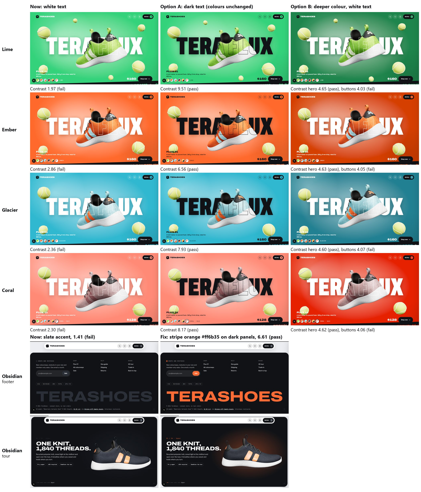

# A4: colour contrast options (OD-8)

| | |
|---|---|
| Task | A4. Colourway tokens and a contrast check |
| Done when | The contrast check passes WCAG AA for every hero colour |
| Status | **Decided 22 Oct 2026: keep the prototype's colours for now.** The 5 pairs stay waived. The options below are kept for when this is revisited |

## The problem

WCAG AA needs a contrast of **4.5:1** for normal text, or 3:1 for large headlines. Five colour pairs fail today, and pass the contrast gate only by waiver:

| Colourway | Pair | Now |
|---|---|---|
| Lime, Ember, Glacier, Coral | White hero text on the bright hero colour | 1.97, 2.86, 2.36, 2.30: even the giant headline fails 3:1 |
| Obsidian | Its slate highlight (#2b3038) used for accents on the dark panels: tour labels, footer wordmark, Join button | 1.41 |

## The options

| Colourway | **A: dark hero text**, colours unchanged | B: deeper colour, white text |
|---|---|---|
| Lime | **9.51 (pass)** | #1e854c: hero 4.65 (pass), buttons and dark-panel accents 4.03 (fail) |
| Ember | **6.56 (pass)** | #d53f00: 4.63 (pass) / 4.05 (fail) |
| Glacier | **7.93 (pass)** | #218091: 4.60 (pass) / 4.07 (fail) |
| Coral | **8.17 (pass)** | #e52100: 4.62 (pass) / 4.06 (fail), and Coral turns red |
| Obsidian (dark panels) | Use its stripe orange #ff6b35 there: **6.61 (pass)**. The tour glow and the Join button turn orange too | — |

**Why B can't fully work:** a colour dark enough for white text (luminance ≤ 0.18) is too dark for the near-black button text and for the accents on the dark panels, which need ≥ 0.20. Option B would also need white button text, and it changes the brand colours much more.

**Recommendation: Option A plus the Obsidian fix.** Every pair passes AA, the brand colours stay as they are, and it's how Amber already looks.

## What changes once you choose

- **Option A:** `heroInk` for Lime, Ember, Glacier and Coral becomes the site's ink (#101216) in `tokens/colourways.json`, and their waivers are removed.
- **Obsidian fix:** a new token, the accent on dark panels, set to #ff6b35 for Obsidian (the other colourways keep their highlight there). Its waiver is removed.
- The contrast gate then passes with no waivers, and the screenshot baselines are updated for the approved change.
