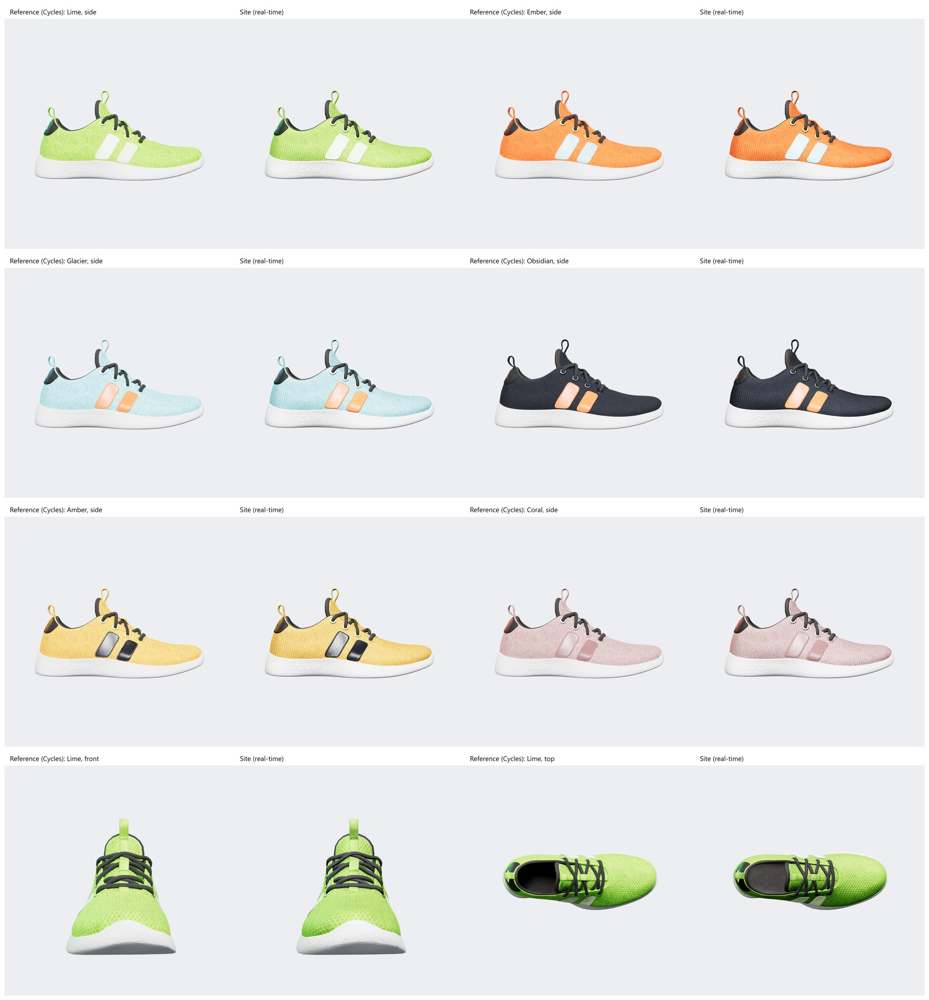

# A6: lighting check against a reference render

| | |
|---|---|
| Task | A6. Studio environment, key and rim lights, contact shadow, matched to a reference render |
| Done when | The product owner approves a side-by-side check |
| Status | ✅ **Approved by the product owner on 22 Oct 2026: keep the lighting as it is** |

## How the check was made

`pnpm assets:lighting` (with `pnpm dev` running) produces the side-by-side images and the numbers. It renders the same shots twice under the **same light rig**:

- **Reference:** Blender 5.2 **Cycles**, a path tracer, so it has real shadows, bounce light and sharp reflections. It renders the prototype's original model and textures (`scripts/assets/lighting_reference.py`).
- **Site:** the site's real-time three.js renderer, through the dev-only product-photo page, on this machine's GPU.

The two can't drift apart, because both read the same light rig:

| Input | Shared how |
|---|---|
| Studio environment | Exported from the site's own three.js environment as an HDR (`src/three/studioEquirect.ts`), so the light coming in is identical by construction |
| Key, fill and rim lights, hemisphere light | `STUDIO_LIGHTS` in `src/three/shoeAssets.ts`, used by the site and handed to Blender. The rim takes each colourway's highlight colour |
| Reflection strength, exposure | `STUDIO_LIGHTS.envMapIntensity` (1.1) and `.exposure` (1.05). Blender's output is tone-mapped with three.js's exact ACES curve |
| Camera | The product photos' framing: 30° field of view, shoe 2 units long, filling 80% of the frame |

## Results

The site's average brightness on the shoe, against the reference:

| Shot | Reference | Site | Site vs reference | Mean per-pixel difference |
|---|---|---|---|---|
| Lime, side | 0.850 | 0.839 | −1.3% | 0.024 |
| Ember, side | 0.763 | 0.748 | −2.0% | 0.032 |
| Glacier, side | 0.853 | 0.842 | −1.3% | 0.026 |
| Obsidian, side | 0.504 | 0.509 | +0.9% | 0.031 |
| Amber, side | 0.805 | 0.790 | −1.9% | 0.032 |
| Coral, side | 0.797 | 0.793 | −0.5% | 0.027 |
| Lime, front | 0.726 | 0.706 | −2.8% | 0.044 |
| Lime, top | 0.530 | 0.516 | −2.6% | 0.093 |

**Every shot is within 3% of the path-traced reference.** Colour, highlights and the rim tint match. The visible differences are small and expected from real-time rendering:

- **Inside the shoe (top view):** the reference's lining is darker, because a path tracer computes real occlusion inside the opening. This is why the top view has the largest per-pixel difference.
- **Small embossed detail** (the "FOAM" lettering on the sole): stronger on the site, which darkens it with the model's baked occlusion texture. The reference sees only the model's actual geometry, where the lettering isn't modelled, so the site's look is the intended one here.
- **Contact shadow:** the site's soft gradient under the shoe (the prototype's look) isn't part of this check. The product photos have a transparent background.

**Recommendation:** no change to the lighting. It is within 3% of the reference, and it is the prototype's approved look.
